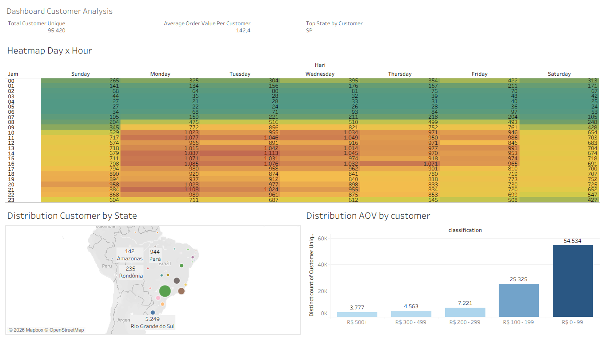

# Olist E-Commerce — Customer Analysis

## Project Overview

This project explores customer distribution and purchasing behavior using the Olist Brazilian E-Commerce dataset.

The analysis looks at where customers are located, how much they spend on average per order, and when they are most active in placing orders.

Through this analysis, I aim to understand Olist's customer base, identify high-value purchasing patterns, and find periods with higher customer activity.

## Business Objectives

This project covers three business cases to better understand Olist's customers and their purchasing behavior.

### Business Case 1: Customer Distribution by State and City

**Objective:** Understand where Olist's customers are located by analyzing their distribution across different states and cities in Brazil. This helps identify areas with the largest customer base.

### Business Case 2: Average Order Value (AOV) per Customer

**Objective:** Analyze the average order value for each customer to identify customers with higher transaction values and understand differences in purchasing value.

### Business Case 3: Customer Purchase Activity by Day and Hour

**Objective:** Identify when customers are most active in placing orders by analyzing purchasing activity across different days and hours.

## Dataset

This project uses the [Olist Brazilian E-Commerce Public Dataset](https://www.kaggle.com/datasets/olistbr/brazilian-ecommerce), which contains information about orders, customers, products, payments, and sellers.

**Main Tables Used:**
- `orders_dataset`
- `customers_dataset`
- `order_items_dataset`

**Data Scope:**
- Customer distribution is analyzed using customer location and unique customer identifiers.
- AOV analysis only includes orders with `order_status = 'delivered'`.
- Purchase activity is analyzed using order purchase dates and times.
- `customer_unique_id` is used to identify unique customers rather than counting customer records or orders as separate customers.

## Tools & Technologies
- Python
- Pandas
- NumPy
- Matplotlib
- Seaborn
- Jupyter Notebook
- Tableau

## Analysis Workflow

1. **Import Libraries** — Import the Python libraries needed for data analysis and visualization.
2. **Data Gathering** — Load the datasets used throughout the analysis.
3. **Data Understanding** — Explore the datasets, including their structure, dimensions, column names, and data types.
4. **Data Quality Assessment & Cleaning** — Check for missing values, duplicates, and inconsistencies, then handle the identified data quality issues.
5. **Data Preparation** — Prepare the data for analysis by merging tables, filtering records, transforming columns, and creating additional features where needed.
6. **Exploratory Data Analysis (EDA)** — Explore customer distribution, purchasing value, and order activity through calculations and visualizations.
7. **Key Insights** — Highlight the main findings from each business case.
8. **Business Implications** — Discuss how the findings could support customer acquisition, customer value analysis, and operational planning.

## Key Findings

### Business Case 1: Customer Distribution by State and City

- São Paulo (SP) had the largest customer base, with **39,981 customers**, followed by Rio de Janeiro (RJ) with **12,303 customers**.
- São Paulo city recorded the highest number of customers at **14,865**, followed by Rio de Janeiro city with **6,576 customers**.

### Business Case 2: Average Order Value (AOV) per Customer

- The customer with the highest average order value recorded **R$13,440**, based on one order containing 8 items.
- The second-highest AOV was **R$7,160**, also based on one order containing 4 items.

### Business Case 3: Customer Purchase Activity by Day and Hour

- Customer activity was highest at **16:00**, with **6,575 customers**.
- Monday recorded the highest activity by day, with **15,852 customers**.
- The busiest day-and-hour combination was **Tuesday at 14:00**, with **1,109 customers**.

## Dashboard Preview

The dashboard brings together the main findings from this analysis, covering customer distribution by location, average order value, and customer purchasing activity by day and hour.

### Interactive Dashboard

**[View the Interactive Dashboard on Tableau Public](https://public.tableau.com/app/profile/adin4572/viz/DashboardCustomerAnalysis_17936250415780/DashboardCustomerAnalysis)**

### Dashboard Screenshot



## Business Implications

The findings highlight a few areas worth considering:

- **Customer Acquisition:** São Paulo and Rio de Janeiro have the largest customer bases. These areas could be considered when planning customer acquisition and engagement activities.
- **Customer Value:** Customers with higher AOV can provide useful examples for understanding high-value transactions and exploring opportunities to increase customer spending.
- **Operational Planning:** Customer activity peaks at 16:00 and on Monday. These patterns may help with planning operational resources during busier periods.
- **Campaign Timing:** Understanding customer activity by day and hour can help identify suitable periods for promotional campaigns and customer engagement.

## Repository Structure

```text
Olist-Customer-Analysis/
├── README.md
├── Customer Analysis.ipynb
└── Dashboard/
    └── Dashboard_Customer_Analysis.png
```

## Conclusion

This project provides a closer look at Olist's customer base and purchasing behavior through geographic distribution, average order value, and order activity patterns.

The analysis shows that customers are concentrated in major states and cities, while purchasing activity is more pronounced at certain times of the day and week. These findings can help provide a better understanding of customer behavior and support future business planning.

## Project Category

**Data Analysis | E-Commerce | Customer Analysis**

**Dataset:** Olist Brazilian E-Commerce Public Dataset
